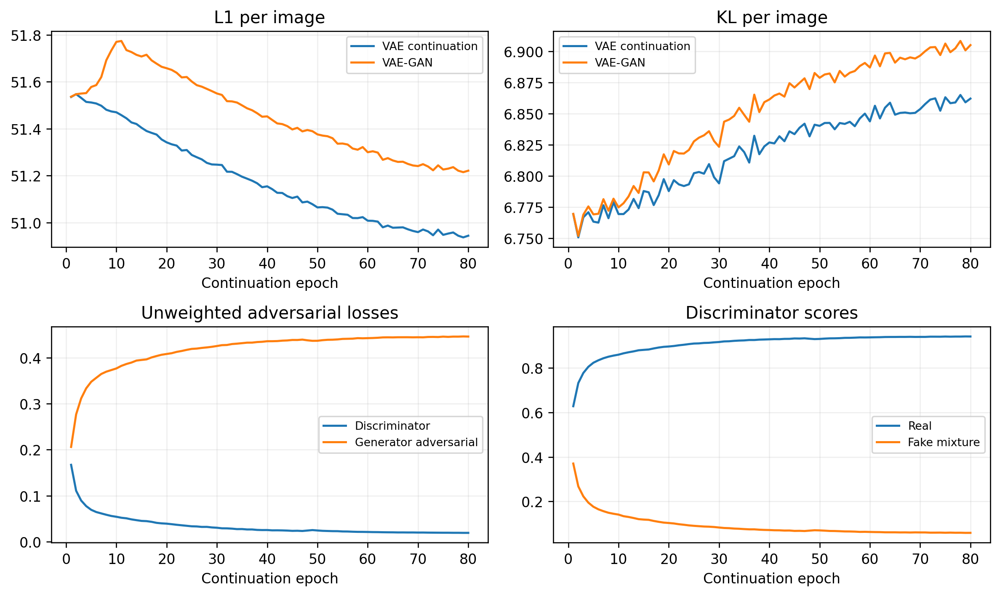
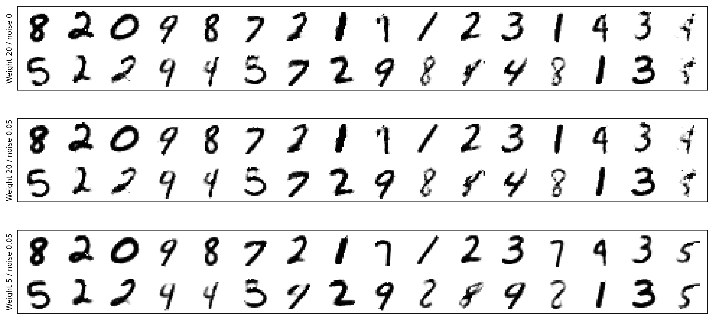
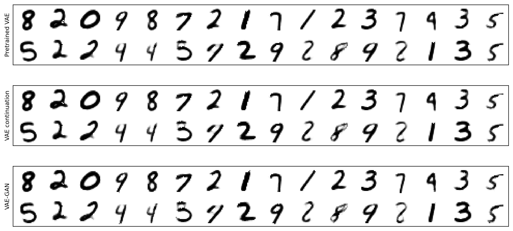
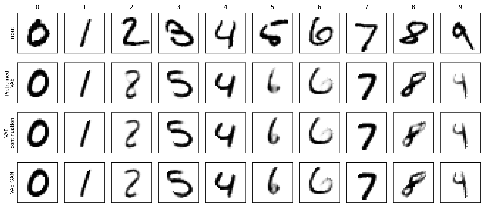
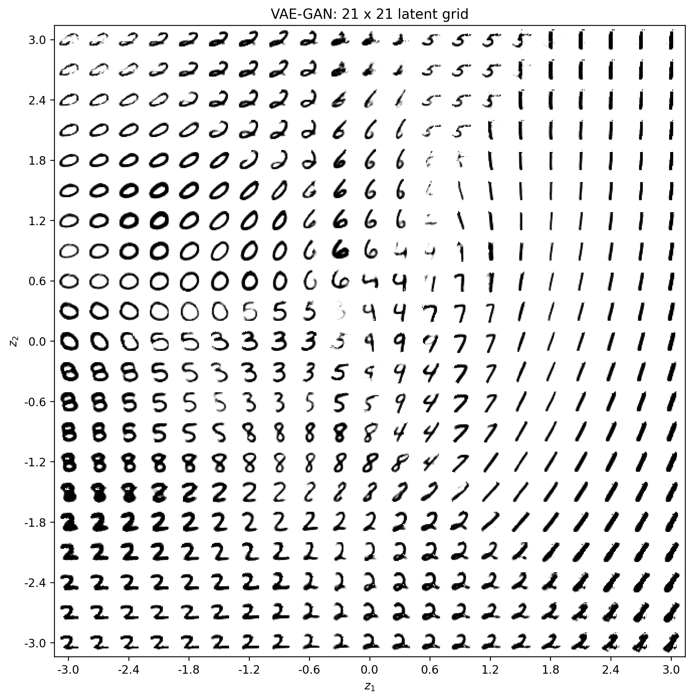
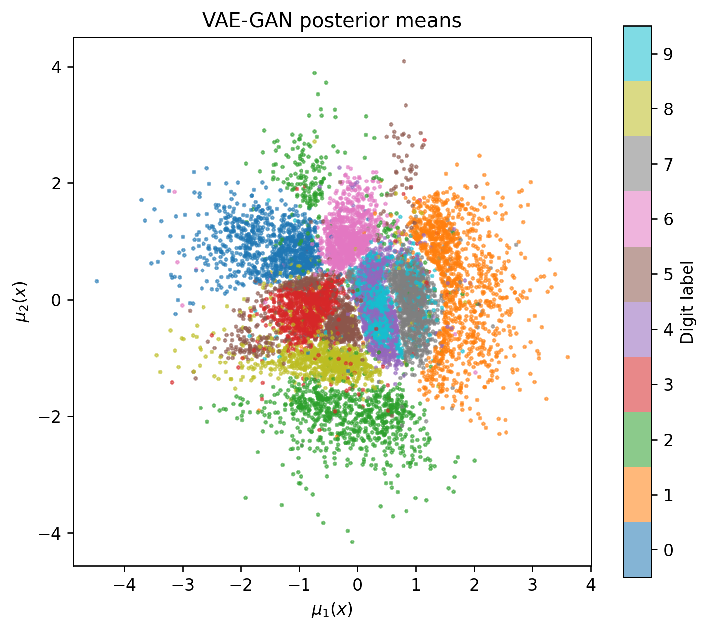
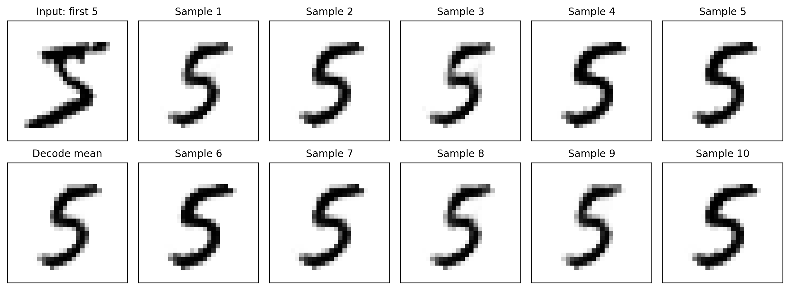

# 基于二维 VAE-GAN 的手写数字生成

## 摘要

在预训练二维变分自编码器的基础上，引入具有谱归一化的卷积判别器，以 L1 重构损失、KL 散度和最小二乘对抗损失联合训练。通过实例噪声与对抗权重消融考察生成质量和重构误差的权衡，并设置相同更新轮次的纯 VAE 对照。完成二维隐空间的 441 点网格生成及固定首个数字 5 的十次重参数化采样。主模型的测试重构 MAE 为 0.06900，相较纯 VAE 继续训练上升 0.72%；MNIST 分类器特征空间中的 Fréchet 距离由 54.547 降至 46.870，下降 14.07%。固定输入的十次输出均保持清晰的数字 5 形态。结果表明，适度对抗约束可改善本实验中的生成特征分布，但二维隐空间仍存在类别混合与比例偏移。

## 1 模型与训练方法

### 1.1 数据与网络结构

使用 MNIST 官方训练集的 60,000 张图像训练模型，以独立的 10,000 张测试图像进行评估。输入为 $28\times28$ 灰度图像，像素除以 255 归一化到 $[0,1]$；VAE 输入不进行二值化、几何增强或类别重采样。生成模型不接收数字标签；标签仅用于选取指定输入、绘制类别分布以及训练独立的评估分类器。

继承预训练二维 VAE 的编码器与解码器，新增卷积判别器，解码器同时承担生成器的功能。网络结构如下。

| 模块 | 结构与激活函数 |
| --- | --- |
| 编码器 $E_\phi$ | 展平输入，$784\to512\to256\to128$；隐藏层均使用 SiLU |
| 后验参数分支 | 均值与对数方差分别通过 $128\to2$ 的线性层输出；对数方差限制在 $[-12,8]$ |
| 解码器 $G_\theta$ | $2\to128\to256\to512\to784$；隐藏层使用 SiLU，输出层使用 Sigmoid |
| 判别器 $D_\psi$ | $1\times28\times28\to32\times14\times14\to64\times7\times7$；两层卷积的核大小均为 4，步长为 2，填充为 1；展平后 $3136\to128\to1$ |
| 判别器激活与归一化 | 隐藏层使用负半轴斜率为 0.2 的 LeakyReLU；所有卷积层、线性层使用谱归一化；输出层为无 Sigmoid 的实数评分 |

VAE 与判别器分别包含 1,133,844 和 435,041 个可训练参数。谱归一化约束权重的谱范数，用于缓和判别器训练中的尺度变化；它不保证对抗优化必然收敛。[Miyato 等](https://arxiv.org/abs/1802.05957)

### 1.2 二维后验与重参数化

设编码器给出的均值为 $\mu_\phi(x)$，对数方差为 $\ell_\phi(x)$，则

$$
q_\phi(z\mid x)=\mathcal N\!\left(\mu_\phi(x),\operatorname{diag}(e^{\ell_\phi(x)})\right),
\qquad p(z)=\mathcal N(0,I_2).
$$

通过重参数化构造后验隐变量：

$$
\epsilon\sim\mathcal N(0,I_2),\qquad
z_q=\mu_\phi(x)+\exp\!\left(\frac{\ell_\phi(x)}2\right)\odot\epsilon,
\qquad \hat x=G_\theta(z_q).
$$

噪声与网络参数独立，梯度可经由 $z_q$ 传回编码器；指数项表示标准差而非方差。[Kingma 与 Welling](https://arxiv.org/abs/1312.6114)

### 1.3 L1 重构、KL 正则与对抗损失

每个批次包含 $B$ 张图像。重构损失对单张图像的 784 个像素取绝对误差之和，再对批次平均：

$$
\mathcal L_{\mathrm{rec}}=\frac1B\sum_{i=1}^{B}\sum_{j=1}^{784}|x_{ij}-\hat x_{ij}|.
$$

KL 正则项为

$$
\mathcal L_{\mathrm{KL}}=-\frac1{2B}\sum_{i=1}^{B}\sum_{k=1}^{2}
\left(1+\ell_{ik}-\mu_{ik}^{2}-e^{\ell_{ik}}\right).
$$

另从先验独立采样 $z_p\sim\mathcal N(0,I_2)$，得到 $x_p=G_\theta(z_p)$。判别器同时接收真实图像、后验重构图像和先验生成图像，使对抗约束覆盖两条生成路径。采用最小二乘 GAN 的 0/1 目标值，真实目标为 1，生成目标为 0；生成器将两类生成图像的评分推向 1。[Mao 等](https://arxiv.org/abs/1611.04076)

训练时在判别器的每次输入上加入独立实例噪声 $\eta\sim\mathcal N(0,0.05^2I_{784})$，记 $\widetilde D_\psi(u)=D_\psi(u+\eta)$。真实、后验和先验图像使用相同噪声强度，不对加噪结果截断。该操作平滑判别器所比较的分布，减弱对微小像素差异的依赖；L1 重构项仍在干净图像上计算，最终生成与评估也不加实例噪声。[Sønderby 等](https://arxiv.org/abs/1610.04490)

记 $\langle\cdot\rangle$ 为批次均值，并以独立采样估计实例噪声期望，判别器目标为

$$
\mathcal L_D=
\frac12\left\langle(\widetilde D_\psi(x)-1)^2\right\rangle+
\frac14\left\langle \widetilde D_\psi(\hat x)^2\right\rangle+
\frac14\left\langle \widetilde D_\psi(x_p)^2\right\rangle.
$$

生成器的对抗项为

$$
\mathcal L_{\mathrm{adv}}=
\frac14\left\langle(\widetilde D_\psi(\hat x)-1)^2\right\rangle+
\frac14\left\langle(\widetilde D_\psi(x_p)-1)^2\right\rangle.
$$

两类生成图像各占虚假样本混合分布的一半，避免仅因增加一条生成分支而将虚假样本权重加倍。编码器与解码器联合最小化

$$
\mathcal L_{E,G}=\mathcal L_{\mathrm{rec}}+\mathcal L_{\mathrm{KL}}
+\lambda_t\mathcal L_{\mathrm{adv}},\qquad
\lambda_t=5\min(1,t/10).
$$

这里的平方误差只作用于判别器评分；图像重构始终采用 L1。本文实现属于保留像素 L1 目标的 VAE-GAN 变体，未用判别器特征距离替代重构项，因此与原始 VAE-GAN 的特征重构目标有所区别。[Larsen 等](https://arxiv.org/abs/1512.09300)

### 1.4 交替更新与梯度路径

每个批次先计算后验重构和先验生成，再执行以下两步：

1. **更新判别器。** 对两类生成图像执行 `detach()`，仅根据 $\mathcal L_D$ 更新 $\psi$，避免判别器更新传播至编码器与解码器。
2. **更新编码器与解码器。** 固定判别器参数，用更新后的判别器重新计算生成评分，再根据 $\mathcal L_{E,G}$ 更新 $\phi,\theta$。此时保留判别器对输入的梯度；使用 `eval()` 固定谱归一化的幂迭代状态，不使用 `no_grad()` 阻断生成器梯度。

后验分支的对抗梯度传至编码器和解码器，先验分支的对抗梯度仅传至解码器。判别器与生成模型的更新次数比为 $1:1$。L1 维持输入内容，KL 约束后验与先验的关系，对抗项促使生成图像具有更接近训练数据的笔画结构。

## 2 实验设置与评价方法

### 2.1 预训练、微调与对照

以已完成 160 轮训练的 VAE 为共同起点，分别进行 80 轮 VAE-GAN 微调与 80 轮纯 VAE 继续训练。主要比较“预训练 VAE”“VAE 继续训练”和“VAE-GAN”，另设置两组较强对抗权重消融，分别使用和不使用实例噪声。所有继续训练路径的生成网络结构、初始权重、批次顺序、后验噪声序列、优化器与学习率计划完全一致；纯 VAE 路径将对抗项置零且不更新判别器。该对照控制生成模型的更新轮次，不等同于控制计算时间。

| 设置 | VAE 预训练 | 继续训练 |
| --- | --- | --- |
| 轮次 / 批次大小 | 160 / 256 | 80 / 256 |
| 优化器 | Adam，$(\beta_1,\beta_2)=(0.9,0.999)$ | Adam，$(0.5,0.999)$；VAE-GAN 的两组优化器配置相同 |
| 学习率 | $10^{-3}$ 余弦衰减至 $5\times10^{-5}$ | $10^{-4}$ 余弦衰减至 $10^{-5}$ |
| KL 权重 | $\min(1,t/15)$ | 固定为 1 |
| 对抗权重 | 0 | 主模型前 10 轮线性升至 5；较强对抗消融升至 20；纯 VAE 为 0 |
| 判别器输入噪声标准差 | 不适用 | 主模型 0.05；两组较强对抗消融分别为 0 和 0.05 |
| 梯度全局二范数上限 | 10 | 10 |
| 初始化随机种子 | 42 | 84；批次、后验噪声、先验噪声、实例噪声分别使用独立的 85、86、87、88 随机流 |
| 权重选择 | 第 160 轮 | 各路径第 80 轮 |

每轮包含 $\lceil60000/256\rceil=235$ 个批次，最后一个批次保留；各继续训练路径均执行 18,800 次生成模型更新。初步较强对抗实验暴露出散点伪影和类别比例偏移，据此增加实例噪声及降低对抗权重的实验，并完整保留全部方案。只比较上述三组对抗配置，噪声标准差未进行多值搜索。本比较属于单次种子下的探索性实验，不能视为独立测试集上的调参后确认性检验。测试数据不参与参数更新，各组统一报告最后一轮，不选择中间最佳权重。训练使用 GPU，启用确定性算法并固定随机种子；不同软件版本或计算后端仍可能产生数值差异。

### 2.2 评价定义

重构质量采用测试集像素平均绝对误差（MAE）。对每张测试图像进行十次后验采样，计算随机重构 MAE；另计算 $G_\theta(\mu_\phi(x))$ 的确定性重构 MAE。随机采样种子为 43，全部模型共用相同噪声。Monte Carlo 标准误按十次全测试集平均 L1 的样本标准差除以 $\sqrt{10}$ 计算，仅反映后验采样误差。

先验生成评价使用种子 2027 产生的同一组 10,000 个 $\mathcal N(0,I_2)$ 样本。为补充视觉判断，独立训练一个 MNIST 分类器：两层 $3\times3$ 卷积的通道数为 32、64，每层接 ReLU 与 $2\times2$ 最大池化；展平后通过 $3136\to64\to10$ 全连接层，64 维特征使用 ReLU。分类器使用训练集标签，以交叉熵和 Adam 训练 6 轮，学习率 $10^{-3}$、批次大小 256、随机种子 123，不参与生成模型的参数更新。分类器训练完成后固定参数，统一用于各组评价，其测试准确率为 98.85%。

以分类器的 64 维特征 $f(x)$ 计算真实测试样本与先验生成样本的 Fréchet 特征距离：

$$
d_f=\|m_r-m_g\|_2^2+
\operatorname{tr}\!\left(S_r+S_g-2(S_r^{1/2}S_gS_r^{1/2})^{1/2}\right).
$$

$m_r,m_g$ 为特征均值，$S_r,S_g$ 为分母取 $n-1$ 的样本协方差。数值计算使用对称特征分解，并将浮点误差引起的微小负特征值截为零。该指标借鉴 FID 的高斯特征分布比较形式，但使用本实验的 MNIST 分类器，**不属于标准 Inception FID，也不能与其他特征网络的数值直接比较**。[Heusel 等](https://arxiv.org/abs/1706.08500)

同时报告分类器最大类别概率的均值，以及该概率不小于 0.9 的样本比例。先验样本没有真实类别标签，这两项是识别置信度指标，不是生成准确率。用预测类别频率 $p_k$ 与测试集真实类别频率 $r_k$ 的总变差距离 $\frac12\sum_{k=0}^{9}|p_k-r_k|$ 检查类别比例偏移，并报告预测类别熵 $-\sum_k p_k\log p_k$。上述统计只能辅助识别明显退化，不能单独证明生成多样性充分或不存在模式坍缩。

## 3 实验结果与分析

### 3.1 训练过程



图 1　两组模型在继续训练阶段的损失。每轮指标按批次样本数加权平均；对抗损失未乘 $\lambda_t$。判别器评分来自其更新前的前向计算，生成器对抗损失使用该批次更新后的判别器。

主模型每图 L1 和在第 1 轮为 51.5359，随对抗权重预热在第 10 轮升至 51.7697，随后逐步下降，第 80 轮为 51.2207；纯 VAE 对照最终为 50.9435。主模型最终 KL 为 6.9050。对抗项引入了区别于逐像素拟合的优化方向，因此训练 L1 略高于纯 VAE 对照并不与生成分布改善矛盾。

最终判别器损失为 0.01957，生成器未加权对抗损失为 0.44557，真实和生成图像的平均评分分别为 0.9416 与 0.0585。训练未出现数值发散，但判别器仍能区分两类图像。若两种分布完全一致且判别器最优，本损失约定下应有 $D=0.5$、$\mathcal L_D=0.25$ 和 $\mathcal L_{\mathrm{adv}}=0.125$；当前记录显然不能作为达到该理想平衡的证据。

### 3.2 与纯 VAE 的对比

| 测试指标 | 预训练 VAE | VAE 继续训练 | VAE-GAN |
| --- | ---: | ---: | ---: |
| 随机后验重构 MAE ↓ | 0.06864 | 0.06850 | 0.06900 |
| 后验均值重构 MAE ↓ | 0.06756 | 0.06747 | 0.06796 |
| 每图平均 KL | 6.7465 | 6.8290 | 6.8745 |
| 每图 L1 的 Monte Carlo 标准误 | 0.00680 | 0.00640 | 0.00673 |
| 重构图像类别一致率 / % ↑ | 83.79 | 83.91 | 84.21 |
| 先验 Fréchet 特征距离 ↓ | 57.117 | 54.547 | 46.870 |
| 先验识别置信度均值 ↑ | 0.9475 | 0.9488 | 0.9528 |
| 先验置信度 ≥ 0.9 的比例 / % ↑ | 86.93 | 87.30 | 88.28 |
| 先验预测类别熵 | 2.2729 | 2.2720 | 2.2733 |
| 先验类别比例总变差距离 ↓ | 0.0847 | 0.0876 | 0.0889 |

表中的重构类别一致率，是分类器对后验均值重构的预测与原图真实标签一致的比例。与纯 VAE 继续训练相比，主模型的先验特征距离下降 14.07%，识别置信度均值由 0.9488 增至 0.9528，高置信度样本比例由 87.30% 增至 88.28%。同时，随机重构 MAE 增加约 0.00049，即相对上升 0.72%；重构类别一致率由 83.91% 增至 84.21%。这体现了以少量像素拟合代价换取生成特征分布改善的取舍。

类别总变差距离由 0.0876 略升至 0.0889，表明类别比例并未同步改善。主模型的 10,000 张先验输出覆盖全部十个预测类别，但其中数字 9 仅占 4.86%，而测试集真实比例为 10.09%；数字 1 的预测比例为 13.36%，高于测试集的 11.35%。因此，较低的特征距离不能解释为完整恢复了真实类别频率。

| 对抗权重 / 噪声标准差 | 重构 MAE ↓ | 特征距离 ↓ | 识别置信度 ↑ | 类别总变差 ↓ |
| --- | ---: | ---: | ---: | ---: |
| 20 / 0 | 0.07169 | 59.810 | 0.9613 | 0.1225 |
| 20 / 0.05 | 0.07177 | 57.930 | 0.9586 | 0.1193 |
| 5 / 0.05 | 0.06900 | 46.870 | 0.9528 | 0.0889 |

在对抗权重保持为 20 时，加入标准差为 0.05 的实例噪声使特征距离由 59.810 降至 57.930，但仍未优于纯 VAE 对照，重构 MAE 也基本未改善。保持实例噪声后，将对抗权重降至 5，特征距离进一步降至 46.870，类别比例偏移和重构代价均减小。图 2 第一行最右侧等位置也显示，较强对抗配置下的破碎笔画在较低权重下有所缓解。本实验支持较低对抗权重与实例噪声组合的适用性，但未单独检验权重为 5 且无实例噪声的配置，不能据此分离二者的全部交互影响。

无实例噪声的较强对抗模型具有最高的平均识别置信度，却对应更大的特征距离和类别总变差距离，说明仅最大化分类器置信度可能掩盖分布失衡。



图 2　三组对抗配置对同一批先验隐变量的输出。上、中、下面板依次为较强对抗且无实例噪声、较强对抗且加入实例噪声，以及本文采用的较低对抗权重模型。各面板均按行排列同一序列的前 32 个样本。



图 3　三组模型对相同先验隐变量的输出。每个横向面板按行展示评估序列中的前 32 个样本；所有样本均按固定次序选取，未根据识别结果筛选。每个面板包含两行，同行同列对应相同隐变量。

三组模型的大部分展示样本均可辨认。主模型保留了预训练 VAE 的主要类别结构，对部分笔画端点、闭环和粗细作出调整；视觉变化总体较为局部。32 张图像用于展示具体形态，分布层面的比较则依据全部 10,000 张输出的统计，不将少量示例视为总体质量的充分证明。



图 4　第一行为测试集中数字 0—9 各自首个样本，其余三行依次为预训练 VAE、VAE 继续训练及 VAE-GAN 的 $G_\theta(\mu_\phi(x))$。选取规则固定，不代表各类别的平均效果。

图 4 中的 0、1、4、7、8 保留了主要轮廓，但输入 3 的重构接近 5，输入 5 接近 6，输入 9 接近 4，输入 6 的闭环有所减弱。这些混淆在主模型中仍然存在，说明对抗损失主要约束输出的分布形态，并不直接保证重构类别与输入一致。

### 3.3 二维隐空间的完整网格生成

令

$$
A=\{-3+0.3k\mid k=0,1,\ldots,20\},\qquad
\mathcal Z=A\times A.
$$

每个坐标轴包含 $6/0.3+1=21$ 个位置，共得到 441 个二维隐变量。直接将全部点输入 VAE-GAN 解码器，不经过编码器。实现使用 `torch.linspace(-3, 3, 21)` 包含两端点，避免浮点步长累积造成数量偏差。



图 5　$[-3,3]\times[-3,3]$ 内的全部生成结果。$z_1$ 从左向右递增，$z_2$ 从下向上递增；相邻格点间隔为 0.3，坐标刻度每隔 0.6 标注。采用统一的 $[0,1]$ 灰度范围，以白底黑字显示，未进行阈值化、锐化或单图对比度调整。

网格左侧上部以 0 为主，右侧以 1 为主，下部以 2 为主；3、4、5、6、7、8、9 主要出现在中部较窄区域。相邻格点呈现连续的倾斜、粗细和闭环变化，体现了二维表示中的局部形态连续性。多数输出具有可辨认的数字结构，但中上部过渡区及部分类别边界仍有浅淡、残缺或混合笔画，极端坐标处也存在形变。图中完整保留这些结果，不能据此声称全部格点均无歧义。

该图是对坐标空间的等间距扫描，不是标准正态先验的随机采样。先验在中心附近密度较高，方形边角区域的密度较低，因此网格内的类别出现比例不能解释为模型按先验生成的类别概率。



图 6　全部测试图像的后验均值，颜色由真实类别标记。类别标签只用于显示。

0、1、2 的后验均值分别集中于左侧、右侧和下部，6 在上部较集中；4、9、7 等类别在中右区域重叠，3 与 5 在中心附近也有交叠。这与网格中的类别过渡以及部分重构混淆相符。该图展示的是后验均值，而非聚合后验的全部随机样本；KL 正则也不要求有限样本的均值分布严格服从标准正态。

### 3.4 固定首个数字 5 的十次重参数化生成

按照 MNIST 训练集的原始顺序，首个标签为 5 的图像索引为 0（从 0 开始计数）。固定这一输入，使用种子 2026 独立生成十组二维标准正态噪声；不调整噪声尺度、不替换输入、不筛选生成结果。

VAE-GAN 对该输入给出的后验参数为

$$
\begin{aligned}
\mu&=(-0.470991,-0.381275),\\
\log\sigma^2&=(-8.084192,-7.175338),\\
\sigma&=(0.017561,0.027663).
\end{aligned}
$$

对每组噪声计算 $z^{(i)}=\mu+\sigma\odot\epsilon^{(i)}$，再输出 $G_\theta(z^{(i)})$。十组噪声与隐变量如下，显示值保留六位小数，生成使用完整浮点数值。

| 样本 | $\epsilon_1$ | $\epsilon_2$ | $z_1$ | $z_2$ |
| ---: | ---: | ---: | ---: | ---: |
| 1 | -0.183910 | 0.729640 | -0.474220 | -0.361091 |
| 2 | 0.624167 | 0.122535 | -0.460030 | -0.377885 |
| 3 | -0.530519 | 1.578949 | -0.480307 | -0.337597 |
| 4 | 1.451069 | -1.079460 | -0.445509 | -0.411135 |
| 5 | 0.958855 | -0.668952 | -0.454153 | -0.399780 |
| 6 | 1.599921 | -0.825115 | -0.442895 | -0.404100 |
| 7 | 0.925685 | 0.684967 | -0.454735 | -0.362327 |
| 8 | -0.603018 | 0.599745 | -0.481580 | -0.364684 |
| 9 | -1.414026 | -0.328409 | -0.495822 | -0.390359 |
| 10 | 1.339672 | -0.222965 | -0.447465 | -0.387442 |



图 7　第一行左侧为固定输入，第二行左侧为后验均值的解码参考；其余位置依次为样本 1—10，共十张随机生成图像。

十次输出均保留数字 5 的上横、转折和下部弯曲结构，差别主要体现在笔画粗细、下弧位置及局部灰度。独立分类器将十张输出全部判为 5，对类别 5 的预测概率介于 0.99969 与 0.99999；这一结果与视觉观察一致，但仅针对该固定训练样本，不代表其他输入的生成准确率。

十张输出与输入的平均像素 MAE 为 0.07703。对全部 $\binom{10}{2}=45$ 对输出计算的平均两两像素 MAE 为 0.01829，说明十次输出并非完全重复。后验标准差约为 0.01756 和 0.02766，明显小于先验标准差 1，因此在固定内容条件下只出现有限的局部变化，与重参数化机制一致。

## 4 结论与局限

在保留二维隐变量和 L1 重构目标的条件下，卷积判别器与最小二乘对抗损失能够与 VAE 联合训练。采用适度对抗权重和实例噪声后，模型在本实验的分类器特征空间中比同轮次纯 VAE 对照更接近真实数据，同时保持较小的重构代价。完整网格展示了数字形态的连续变化，固定首个数字 5 的十次后验输出均清晰可辨。

改进具有明确边界：类别比例仍有偏移，二维表示中的类别重叠尚未消除，判别器仍能区分真实和生成样本；更强的对抗权重也未带来更好的综合效果。本文仅比较一个训练种子，评价依赖特定分类器及有限样本，且模型调整参考了初步实验诊断，因此未对优势作跨种子显著性或普遍性判断。后续可通过多个独立种子与单独验证集复核权重选择，并研究更高维隐空间或更强解码器对类别混淆的影响。

## 参考文献

1. Kingma D P, Welling M. [Auto-Encoding Variational Bayes](https://arxiv.org/abs/1312.6114). ICLR, 2014.
2. Larsen A B L, Sønderby S K, Larochelle H, Winther O. [Autoencoding beyond pixels using a learned similarity metric](https://proceedings.mlr.press/v48/larsen16.html). ICML, 2016.
3. Mao X, Li Q, Xie H, et al. [Least Squares Generative Adversarial Networks](https://arxiv.org/abs/1611.04076). ICCV, 2017.
4. Miyato T, Kataoka T, Koyama M, Yoshida Y. [Spectral Normalization for Generative Adversarial Networks](https://arxiv.org/abs/1802.05957). ICLR, 2018.
5. Heusel M, Ramsauer H, Unterthiner T, et al. [GANs Trained by a Two Time-Scale Update Rule Converge to a Local Nash Equilibrium](https://arxiv.org/abs/1706.08500). NeurIPS, 2017.
6. Sønderby C K, Caballero J, Theis L, Shi W, Huszár F. [Amortised MAP Inference for Image Super-resolution](https://arxiv.org/abs/1610.04490). ICLR, 2017.

## 附录：完整可运行的 PyTorch 实现

### 运行说明

下列代码共 576 行，包含数据下载、VAE 预训练、对抗微调与对照消融、独立分类器训练、全部指标计算及绘图。复现时，在新建文件夹中创建 `src/` 子目录，将本附录代码保存为 `src/vaegan.py`，再于该文件夹运行以下命令。依赖为 Python 3.12、PyTorch 2.11.0、torchvision 0.26.0、NumPy 2.4.3 和 Matplotlib 3.10.8；PyTorch 与 torchvision 使用相匹配的计算后端构建。

```powershell
python -m pip install torch==2.11.0 torchvision==0.26.0 numpy==2.4.3 matplotlib==3.10.8
python src/vaegan.py --mode all
```

程序自动下载 MNIST 并创建 `data/`、`artifacts/` 和 `results/`，优先使用 CUDA，无 CUDA 时使用 CPU。首次运行从 160 轮 VAE 预训练开始，随后执行全部实验，无需随附源码或模型文件。本文实验继承了已完成的预训练权重，并统一采用第 80 轮继续训练后的权重进行评价。

训练完成后，可仅重新计算指标和绘图：

```powershell
python src/vaegan.py --mode generate
```

程序固定采样规则，保存原始数组、十组噪声与隐变量、训练记录、模型参数及完整性摘要。以下为完整实现。

```python
"""Reproduce two-dimensional MNIST VAE-GAN training and evaluation."""
import argparse
import copy
import csv
import hashlib
import json
import math
import os
import random
import sys
from pathlib import Path

os.environ.setdefault("CUBLAS_WORKSPACE_CONFIG", ":4096:8")
os.environ.setdefault("MKL_THREADING_LAYER", "SEQUENTIAL")
import matplotlib
matplotlib.use("Agg")
import matplotlib.pyplot as plt
import numpy as np
import torch
import torch.nn.functional as F
import torchvision
from torch import nn
from torch.nn.utils.parametrizations import spectral_norm
from torchvision.datasets import MNIST

ROOT = Path(__file__).resolve().parents[1]
ART = ROOT / "artifacts"
OUT = ROOT / "results"


class VAE(nn.Module):
    def __init__(self):
        super().__init__()
        self.encoder = nn.Sequential(
            nn.Linear(784, 512), nn.SiLU(), nn.Linear(512, 256), nn.SiLU(),
            nn.Linear(256, 128), nn.SiLU())
        self.mu = nn.Linear(128, 2)
        self.logvar = nn.Linear(128, 2)
        self.decoder = nn.Sequential(
            nn.Linear(2, 128), nn.SiLU(), nn.Linear(128, 256), nn.SiLU(),
            nn.Linear(256, 512), nn.SiLU(), nn.Linear(512, 784), nn.Sigmoid())

    def encode(self, x):
        h = self.encoder(x.flatten(1))
        return self.mu(h), self.logvar(h).clamp(-12, 8)

    @staticmethod
    def reparameterize(mu, logvar, eps):
        return mu + torch.exp(0.5 * logvar) * eps

    def forward(self, x, eps):
        mu, logvar = self.encode(x)
        return self.decoder(self.reparameterize(mu, logvar, eps)), mu, logvar


class Discriminator(nn.Module):
    def __init__(self):
        super().__init__()
        self.net = nn.Sequential(
            spectral_norm(nn.Conv2d(1, 32, 4, 2, 1)), nn.LeakyReLU(0.2),
            spectral_norm(nn.Conv2d(32, 64, 4, 2, 1)), nn.LeakyReLU(0.2),
            nn.Flatten(), spectral_norm(nn.Linear(64 * 7 * 7, 128)),
            nn.LeakyReLU(0.2), spectral_norm(nn.Linear(128, 1)))

    def forward(self, x):
        return self.net(x.reshape(-1, 1, 28, 28)).flatten()


class Classifier(nn.Module):
    """Independent evaluator; never supplies gradients to the generator."""
    def __init__(self):
        super().__init__()
        self.conv = nn.Sequential(
            nn.Conv2d(1, 32, 3, padding=1), nn.ReLU(), nn.MaxPool2d(2),
            nn.Conv2d(32, 64, 3, padding=1), nn.ReLU(), nn.MaxPool2d(2),
            nn.Flatten(), nn.Linear(64 * 7 * 7, 64), nn.ReLU())
        self.head = nn.Linear(64, 10)

    def forward(self, x):
        features = self.conv(x.reshape(-1, 1, 28, 28))
        return self.head(features), features


def seed_all(seed):
    random.seed(seed)
    np.random.seed(seed)
    torch.manual_seed(seed)
    torch.cuda.manual_seed_all(seed)
    torch.set_num_threads(4)
    torch.use_deterministic_algorithms(True)
    torch.backends.cudnn.benchmark = False
    torch.backends.cudnn.deterministic = True


def write_json(path, value):
    path.write_text(json.dumps(value, indent=2, ensure_ascii=False) + "\n",
                    encoding="utf-8", newline="\n")


def write_csv(path, rows):
    with path.open("w", newline="", encoding="utf-8") as stream:
        writer = csv.DictWriter(stream, fieldnames=list(rows[0]),
                                lineterminator="\n")
        writer.writeheader()
        writer.writerows(rows)


def digest(path):
    return hashlib.sha256(path.read_bytes()).hexdigest()


def loss_terms(pred, x, mu, logvar):
    l1 = F.l1_loss(pred, x, reduction="none").sum(1)
    kl = -0.5 * (1 + logvar - mu.square() - logvar.exp()).sum(1)
    return l1.mean(), kl.mean()


def d_loss(real, reconstruction, prior):
    return (0.5 * (real - 1).square().mean()
            + 0.25 * reconstruction.square().mean()
            + 0.25 * prior.square().mean())


def g_loss(reconstruction, prior):
    return 0.25 * ((reconstruction - 1).square().mean()
                   + (prior - 1).square().mean())


def load_data(device):
    train = MNIST(ROOT / "data", train=True, download=True)
    test = MNIST(ROOT / "data", train=False, download=True)
    x = train.data.flatten(1).to(device, torch.float32).div_(255)
    xt = test.data.flatten(1).to(device, torch.float32).div_(255)
    assert x.shape == (60000, 784) and xt.shape == (10000, 784)
    return x, xt, train.targets.to(device), test.targets.to(device)


def load_vae(name, device):
    checkpoint = torch.load(ART / name, map_location=device, weights_only=True)
    model = VAE().to(device)
    model.load_state_dict(checkpoint["model"])
    return model, checkpoint


def pretrain(x, args):
    """Standalone route matching the original VAE initialization and schedule."""
    seed_all(42)
    model = VAE().to(x.device)
    optimizer = torch.optim.Adam(model.parameters(), lr=1e-3)
    scheduler = torch.optim.lr_scheduler.CosineAnnealingLR(
        optimizer, args.pretrain_epochs, eta_min=5e-5)
    rows = []
    for epoch in range(1, args.pretrain_epochs + 1):
        total = torch.zeros(2, device=x.device)
        beta = min(1.0, epoch / 15)
        for ids in torch.randperm(len(x), device=x.device).split(args.batch_size):
            batch = x[ids]
            pred, mu, lv = model(batch, torch.randn(len(ids), 2, device=x.device))
            l1, kl = loss_terms(pred, batch, mu, lv)
            optimizer.zero_grad(set_to_none=True)
            (l1 + beta * kl).backward()
            nn.utils.clip_grad_norm_(model.parameters(), 10)
            optimizer.step()
            total += torch.stack((l1.detach(), kl.detach())) * len(ids)
        row = dict(epoch=epoch, l1=float(total[0] / len(x)),
                   kl=float(total[1] / len(x)), beta=beta)
        rows.append(row)
        scheduler.step()
        if epoch == 1 or epoch % 10 == 0:
            print(f"Pretrain {epoch:03d}: L1={row['l1']:.4f}", flush=True)
    torch.save(dict(model=model.state_dict(), history=rows,
                    config=dict(epochs=args.pretrain_epochs, batch_size=args.batch_size,
                                lr=1e-3, warmup=15, seed=42)), ART / "vae_base.pt")


def train_variant(x, args, adversarial):
    seed_all(args.seed)
    model, _ = load_vae("vae_base.pt", x.device)
    disc = Discriminator().to(x.device)
    opt_g = torch.optim.Adam(model.parameters(), lr=args.lr, betas=(0.5, 0.999))
    opt_d = torch.optim.Adam(disc.parameters(), lr=args.lr, betas=(0.5, 0.999))
    schedulers = [torch.optim.lr_scheduler.CosineAnnealingLR(
        opt, args.epochs, eta_min=args.lr * 0.1) for opt in (opt_g, opt_d)]
    order_rng = torch.Generator(device=x.device).manual_seed(args.seed + 1)
    noise_rng = torch.Generator(device=x.device).manual_seed(args.seed + 2)
    prior_rng = torch.Generator(device=x.device).manual_seed(args.seed + 3)
    disc_rng = torch.Generator(device=x.device).manual_seed(args.seed + 4)
    name = args.run_name if adversarial else "vae_control"
    def noisy(images):
        noise = torch.randn(images.shape, device=x.device, generator=disc_rng)
        return images + args.instance_noise * noise
    rows = []
    for epoch in range(1, args.epochs + 1):
        model.train()
        weight = args.adv_weight * min(1.0, epoch / args.adv_warmup)
        weight = weight if adversarial else 0.0
        total = torch.zeros(7, device=x.device)
        order = torch.randperm(len(x), device=x.device, generator=order_rng)
        for ids in order.split(args.batch_size):
            batch = x[ids]
            eps = torch.randn(len(ids), 2, device=x.device, generator=noise_rng)
            pred, mu, lv = model(batch, eps)
            l1, kl = loss_terms(pred, batch, mu, lv)
            zero = torch.zeros((), device=x.device)
            ld, adv, real_score, fake_score = zero, zero, zero, zero
            if adversarial:
                z = torch.randn(len(ids), 2, device=x.device, generator=prior_rng)
                prior = model.decoder(z)
                disc.train().requires_grad_(True)
                opt_d.zero_grad(set_to_none=True)
                dr = disc(noisy(batch))
                dq, dp = disc(noisy(pred.detach())), disc(noisy(prior.detach()))
                ld = d_loss(dr, dq, dp)
                ld.backward()
                nn.utils.clip_grad_norm_(disc.parameters(), 10)
                opt_d.step()
                opt_d.zero_grad(set_to_none=True)
                disc.eval().requires_grad_(False)
                adv = g_loss(disc(noisy(pred)), disc(noisy(prior)))
                real_score = dr.detach().mean()
                fake_score = 0.5 * (dq.detach().mean() + dp.detach().mean())
            objective = l1 + kl + weight * adv
            if not torch.isfinite(objective + ld):
                raise RuntimeError("Non-finite training objective")
            opt_g.zero_grad(set_to_none=True)
            objective.backward()
            nn.utils.clip_grad_norm_(model.parameters(), 10)
            opt_g.step()
            values = (l1, kl, ld, adv, objective, real_score, fake_score)
            total += torch.stack([v.detach() for v in values]) * len(ids)
        keys = ("l1", "kl", "d_loss", "g_adv", "objective", "d_real", "d_fake")
        row = dict(epoch=epoch, adv_weight=weight, lr=opt_g.param_groups[0]["lr"])
        row.update(zip(keys, (total / len(x)).tolist()))
        rows.append(row)
        schedulers[0].step()
        if adversarial:
            schedulers[1].step()
        write_csv(OUT / f"{name}_history.csv", rows)
        torch.save(dict(model=model.state_dict(), discriminator=disc.state_dict(),
                        config=vars(args), history=rows, epoch=epoch,
                        baseline_sha256=digest(ART / "vae_base.pt")),
                   ART / f"{name}.pt")
        if epoch == 1 or epoch % 5 == 0 or epoch == args.epochs:
            print(f"{name} {epoch:03d}: L1={row['l1']:.4f}, KL={row['kl']:.4f}, "
                  f"D={row['d_loss']:.4f}, Gadv={row['g_adv']:.4f}", flush=True)


def train_classifier(x, labels, args):
    seed_all(123)
    model = Classifier().to(x.device)
    optimizer = torch.optim.Adam(model.parameters(), lr=1e-3)
    rows = []
    for epoch in range(1, args.classifier_epochs + 1):
        total = torch.zeros(2, device=x.device)
        for ids in torch.randperm(len(x), device=x.device).split(256):
            logits, _ = model(x[ids])
            loss = F.cross_entropy(logits, labels[ids])
            optimizer.zero_grad(set_to_none=True)
            loss.backward()
            optimizer.step()
            total[0] += loss.detach() * len(ids)
            total[1] += (logits.argmax(1) == labels[ids]).sum()
        rows.append(dict(epoch=epoch, loss=float(total[0] / len(x)),
                         accuracy=float(total[1] / len(x))))
        print(f"Classifier {epoch:02d}: accuracy={rows[-1]['accuracy']:.4f}",
              flush=True)
    torch.save(dict(model=model.state_dict(), history=rows), ART / "classifier.pt")
    write_csv(OUT / "classifier_history.csv", rows)


@torch.inference_mode()
def classify(model, x):
    probabilities, features = [], []
    for batch in x.split(512):
        logits, feature = model(batch)
        probabilities.append(logits.softmax(1).cpu())
        features.append(feature.cpu())
    return torch.cat(probabilities), torch.cat(features).numpy().astype(np.float64)


def feature_distance(a, b):
    """Frechet distance in this evaluator's 64-D features; not Inception FID."""
    ca, cb = np.cov(a, rowvar=False), np.cov(b, rowvar=False)
    eigenvalues, eigenvectors = np.linalg.eigh(ca)
    sqrt_a = (eigenvectors * np.sqrt(eigenvalues.clip(0))) @ eigenvectors.T
    middle = sqrt_a @ cb @ sqrt_a
    cross = np.sqrt(np.linalg.eigvalsh((middle + middle.T) / 2).clip(0)).sum()
    value = np.square(a.mean(0) - b.mean(0)).sum() + np.trace(ca + cb) - 2 * cross
    return float(max(value, 0))


@torch.inference_mode()
def evaluate(model, test):
    rng = torch.Generator().manual_seed(43)
    draws = torch.zeros(10, device=test.device)
    mean_error = torch.zeros((), device=test.device)
    kl_total = torch.zeros_like(mean_error)
    mus = []
    for batch in test.split(512):
        mu, lv = model.encode(batch)
        mus.append(mu.cpu())
        deterministic = model.decoder(mu)
        mean_error += (deterministic - batch).abs().sum()
        kl_total += (-0.5 * (1 + lv - mu.square() - lv.exp()).sum())
        for draw in range(10):
            eps = torch.randn(mu.shape, generator=rng).to(test.device)
            pred = model.decoder(model.reparameterize(mu, lv, eps))
            draws[draw] += (pred - batch).abs().sum()
    draws = draws / len(test)
    metrics = dict(posterior_l1=float(draws.mean()),
                   posterior_l1_mc_se=float(draws.std() / math.sqrt(10)),
                   posterior_mae=float(draws.mean() / 784),
                   mean_mae=float(mean_error / len(test) / 784),
                   kl=float(kl_total / len(test)))
    return metrics, torch.cat(mus)


def make_grid():
    coordinates = torch.linspace(-3, 3, 21)
    yy, xx = torch.meshgrid(coordinates.flip(0), coordinates, indexing="ij")
    return torch.stack((xx.flatten(), yy.flatten()), 1)


def mosaic(images, rows, cols, gap=2):
    images = np.asarray(images).reshape(rows, cols, 28, 28)
    canvas = np.zeros((rows * (28 + gap) - gap, cols * (28 + gap) - gap))
    for row in range(rows):
        for col in range(cols):
            y, x = row * (28 + gap), col * (28 + gap)
            canvas[y:y + 28, x:x + 28] = images[row, col]
    return canvas


def save_figure(fig, name):
    fig.savefig(OUT / name, dpi=240, bbox_inches="tight", facecolor="white")
    plt.close(fig)


def show_digits(axes, images, titles):
    for ax, pixels, title in zip(np.asarray(axes).flat, images, titles):
        ax.imshow(np.asarray(pixels).reshape(28, 28), cmap="gray_r",
                  vmin=0, vmax=1, interpolation="nearest")
        ax.set_title(title, fontsize=10)
        ax.set_xticks([])
        ax.set_yticks([])


def make_figures(arrays, histories, test_y):
    grid = arrays["vaegan_grid"]
    fig, ax = plt.subplots(figsize=(10, 10))
    ax.imshow(mosaic(grid, 21, 21), cmap="gray_r", vmin=0, vmax=1,
              interpolation="nearest")
    ticks = np.arange(0, 21, 2)
    ax.set_xticks(ticks * 30 + 13.5, [f"{v:.1f}" for v in np.linspace(-3, 3, 21)[ticks]])
    ax.set_yticks(ticks * 30 + 13.5, [f"{v:.1f}" for v in np.linspace(3, -3, 21)[ticks]])
    ax.set(xlabel="$z_1$", ylabel="$z_2$", title="VAE-GAN: 21 x 21 latent grid")
    save_figure(fig, "latent_grid.png")
    fig, axes = plt.subplots(2, 6, figsize=(11, 4.2))
    pictures = [arrays["first_five"], *arrays["vaegan_five"][:5],
                arrays["vaegan_five_mean"], *arrays["vaegan_five"][5:]]
    titles = ["Input: first 5", *[f"Sample {i}" for i in range(1, 6)],
              "Decode mean", *[f"Sample {i}" for i in range(6, 11)]]
    show_digits(axes, pictures, titles)
    fig.tight_layout()
    save_figure(fig, "five_samples.png")
    names = ["vae_base", "vae_control", "vaegan"]
    labels = ["Pretrained VAE", "VAE continuation", "VAE-GAN"]
    fig, axes = plt.subplots(1, 3, figsize=(13, 4.5))
    for ax, name, label in zip(axes, names, labels):
        ax.imshow(mosaic(arrays[f"{name}_grid"], 21, 21), cmap="gray_r",
                  vmin=0, vmax=1, interpolation="nearest")
        ax.set_title(label)
        ax.axis("off")
    fig.tight_layout()
    save_figure(fig, "grid_comparison.png")
    fig, axes = plt.subplots(4, 10, figsize=(11, 4.9))
    show_digits(axes[0], arrays["class_inputs"], [str(i) for i in range(10)])
    axes[0, 0].set_ylabel("Input", fontsize=9)
    for row, (name, label) in enumerate(zip(names, labels), 1):
        show_digits(axes[row], arrays[f"{name}_class_recon"], [""] * 10)
        axes[row, 0].set_ylabel(label.replace(" ", "\n"), fontsize=8)
    fig.tight_layout()
    save_figure(fig, "reconstructions.png")
    fig, axes = plt.subplots(3, 1, figsize=(11, 5.5))
    for ax, name, label in zip(axes, names, labels):
        ax.imshow(mosaic(arrays[f"{name}_prior"][:32], 2, 16), cmap="gray_r",
                  vmin=0, vmax=1, interpolation="nearest")
        ax.set_ylabel(label, fontsize=9)
        ax.set_xticks([])
        ax.set_yticks([])
    fig.tight_layout()
    save_figure(fig, "prior_comparison.png")
    fig, axes = plt.subplots(3, 1, figsize=(11, 5.5))
    ablation_names = ["vaegan_no_noise", "vaegan_strong", "vaegan"]
    ablation_labels = ["Weight 20 / noise 0", "Weight 20 / noise 0.05",
                       "Weight 5 / noise 0.05"]
    for ax, name, label in zip(axes, ablation_names, ablation_labels):
        ax.imshow(mosaic(arrays[f"{name}_prior"][:32], 2, 16), cmap="gray_r",
                  vmin=0, vmax=1, interpolation="nearest")
        ax.set_ylabel(label, fontsize=8)
        ax.set_xticks([])
        ax.set_yticks([])
    fig.tight_layout()
    save_figure(fig, "ablation_comparison.png")
    fig, axes = plt.subplots(2, 2, figsize=(10, 6))
    for ax, key, title in zip(axes.flat[:2], ["l1", "kl"], ["L1 per image", "KL per image"]):
        for name, label in zip(names[1:], labels[1:]):
            rows = histories[name]
            ax.plot([r["epoch"] for r in rows], [r[key] for r in rows], label=label)
        ax.set_title(title)
        ax.legend(fontsize=8)
    rows = histories["vaegan"]
    for key, label in [("d_loss", "Discriminator"), ("g_adv", "Generator adversarial")]:
        axes[1, 0].plot([r["epoch"] for r in rows], [r[key] for r in rows], label=label)
    axes[1, 0].set_title("Unweighted adversarial losses")
    axes[1, 0].legend(fontsize=8)
    for key, label in [("d_real", "Real"), ("d_fake", "Fake mixture")]:
        axes[1, 1].plot([r["epoch"] for r in rows], [r[key] for r in rows], label=label)
    axes[1, 1].set_title("Discriminator scores")
    axes[1, 1].legend(fontsize=8)
    for ax in axes.flat:
        ax.set_xlabel("Continuation epoch")
        ax.grid(alpha=0.2)
    fig.tight_layout()
    save_figure(fig, "training_curves.png")
    fig, ax = plt.subplots(figsize=(7, 6))
    mu = arrays["vaegan_test_mu"]
    scatter = ax.scatter(mu[:, 0], mu[:, 1], c=test_y, cmap="tab10",
                         vmin=-0.5, vmax=9.5, s=3, alpha=0.55, rasterized=True)
    fig.colorbar(scatter, ax=ax, ticks=range(10), label="Digit label")
    ax.set(xlabel="$\\mu_1(x)$", ylabel="$\\mu_2(x)$", title="VAE-GAN posterior means")
    ax.set_aspect("equal", adjustable="box")
    save_figure(fig, "latent_scatter.png")


@torch.inference_mode()
def generate(x, test, labels, test_y):
    classifier = Classifier().to(x.device).eval()
    checkpoint = torch.load(ART / "classifier.pt", map_location=x.device, weights_only=True)
    classifier.load_state_dict(checkpoint["model"])
    real_prob, real_features = classify(classifier, test)
    accuracy = float((real_prob.argmax(1) == test_y.cpu()).float().mean())
    grid_z = make_grid()
    prior_z = torch.randn(10000, 2, generator=torch.Generator().manual_seed(2027))
    eps = torch.randn(10, 2, generator=torch.Generator().manual_seed(2026))
    index = int(torch.where(labels == 5)[0][0])
    original = x[index:index + 1]
    ids = [int(torch.where(test_y == label)[0][0]) for label in range(10)]
    arrays = dict(grid_z=grid_z.numpy(), prior_z=prior_z.numpy(), epsilon=eps.numpy(),
                  first_five=original.cpu().numpy(), class_inputs=test[ids].cpu().numpy())
    metrics, histories = {}, {}
    for name in ["vae_base", "vae_control", "vaegan_no_noise", "vaegan_strong", "vaegan"]:
        model, checkpoint = load_vae(f"{name}.pt", x.device)
        model.eval()
        result, test_mu = evaluate(model, test)
        result["config"] = checkpoint["config"]
        prior = torch.cat([model.decoder(z.to(x.device)) for z in prior_z.split(512)])
        probabilities, features = classify(classifier, prior)
        counts = torch.bincount(probabilities.argmax(1), minlength=10)
        real_counts = torch.bincount(test_y.cpu(), minlength=10)
        proportions = counts.double() / len(prior)
        target_proportions = real_counts.double() / len(test)
        confidence = probabilities.max(1).values
        result.update(feature_frechet=feature_distance(real_features, features),
                      prior_confidence=float(confidence.mean()),
                      prior_confident_fraction=float((confidence >= 0.9).float().mean()),
                      prior_class_counts=counts.tolist(),
                      prior_class_entropy=float(-(
                          proportions * proportions.clamp_min(1e-12).log()).sum()),
                      prior_class_tv=float((proportions - target_proportions).abs().sum() / 2))
        grid = model.decoder(grid_z.to(x.device))
        mu, lv = model.encode(original)
        z = model.reparameterize(mu, lv, eps.to(x.device))
        five = model.decoder(z)
        five_prob, _ = classify(classifier, five)
        result["first_five"] = dict(index=index, split="train", noise_seed=2026,
            mu=mu[0].cpu().tolist(), logvar=lv[0].cpu().tolist(),
            std=(0.5 * lv[0]).exp().cpu().tolist(),
            predictions=five_prob.argmax(1).tolist(),
            class5_probabilities=five_prob[:, 5].tolist(),
            pairwise_mae=float(torch.pdist(five, p=1).mean() / 784),
            input_mae=float((five - original).abs().mean()))
        mean_recons = torch.cat([model.decoder(m.to(x.device)) for m in test_mu.split(512)])
        recon_prob, _ = classify(classifier, mean_recons)
        result["reconstruction_label_accuracy"] = float(
            (recon_prob.argmax(1) == test_y.cpu()).float().mean())
        for suffix, value in dict(grid=grid, prior=prior[:32], five=five, five_z=z,
                five_mu=mu, five_logvar=lv, five_mean=model.decoder(mu), test_mu=test_mu,
                class_recon=mean_recons[ids]).items():
            arrays[f"{name}_{suffix}"] = value.cpu().numpy()
        histories[name] = checkpoint["history"]
        write_csv(OUT / f"{name}_history.csv", checkpoint["history"])
        metrics[name] = result
        print(f"{name}: MAE={result['posterior_mae']:.6f}, "
              f"feature distance={result['feature_frechet']:.3f}, "
              f"confidence={result['prior_confidence']:.4f}", flush=True)
    model, checkpoint = load_vae("vaegan.pt", x.device)
    metrics["experiment"] = dict(config=checkpoint["config"],
        baseline_config=load_vae("vae_base.pt", x.device)[1]["config"],
        classifier_test_accuracy=accuracy,
        vae_parameters=sum(p.numel() for p in model.parameters()),
        discriminator_parameters=sum(p.numel() for p in Discriminator().parameters()),
        prior_samples=10000, prior_seed=2027, posterior_mc_draws=10, posterior_seed=43,
        test_class_counts=torch.bincount(test_y.cpu(), minlength=10).tolist(),
        grid_count=441, grid_min=-3, grid_max=3, grid_step=0.3,
        versions=dict(python=sys.version.split()[0], torch=torch.__version__,
                      torchvision=torchvision.__version__, numpy=np.__version__,
                      matplotlib=matplotlib.__version__))
    metrics["experiment"]["classifier_epochs"] = len(torch.load(
        ART / "classifier.pt", map_location="cpu", weights_only=True)["history"])
    make_figures(arrays, histories, test_y.cpu().numpy())
    rows = [dict(sample=i + 1, epsilon_1=float(e[0]), epsilon_2=float(e[1]),
                 z_1=float(z[0]), z_2=float(z[1]))
            for i, (e, z) in enumerate(zip(eps, arrays["vaegan_five_z"]))]
    write_csv(OUT / "five_samples.csv", rows)
    write_json(OUT / "metrics.json", metrics)
    np.savez_compressed(OUT / "samples.npz", **arrays)
    files = [Path(__file__), *sorted(ART.glob("*.pt")),
             *sorted(OUT.glob("*.png")), *sorted(OUT.glob("*.csv")),
             OUT / "samples.npz", OUT / "metrics.json"]
    write_json(OUT / "sha256.json", {p.relative_to(ROOT).as_posix(): digest(p) for p in files})


def main():
    parser = argparse.ArgumentParser(description=__doc__)
    parser.add_argument("--mode", default="all", choices=[
        "all", "pretrain", "gan", "ablation", "control", "classifier", "generate"])
    parser.add_argument("--pretrain-epochs", type=int, default=160)
    parser.add_argument("--epochs", type=int, default=80)
    parser.add_argument("--classifier-epochs", type=int, default=6)
    parser.add_argument("--batch-size", type=int, default=256)
    parser.add_argument("--lr", type=float, default=1e-4)
    parser.add_argument("--adv-weight", type=float, default=5)
    parser.add_argument("--adv-warmup", type=int, default=10)
    parser.add_argument("--instance-noise", type=float, default=0.05)
    parser.add_argument("--run-name", default="vaegan", choices=[
        "vaegan", "vaegan_no_noise", "vaegan_strong", "vaegan_balanced"])
    parser.add_argument("--seed", type=int, default=84)
    args = parser.parse_args()
    if min(args.pretrain_epochs, args.epochs, args.classifier_epochs,
           args.batch_size, args.adv_warmup) < 1 or args.lr <= 0 or args.adv_weight < 0:
        parser.error("Invalid training configuration")
    if args.instance_noise < 0:
        parser.error("Instance noise must be nonnegative")
    seed_all(args.seed)
    ART.mkdir(exist_ok=True)
    OUT.mkdir(exist_ok=True)
    device = torch.device("cuda" if torch.cuda.is_available() else "cpu")
    x, test, labels, test_y = load_data(device)
    if args.mode == "pretrain" or (args.mode == "all" and not (ART / "vae_base.pt").exists()):
        pretrain(x, args)
    if args.mode in ("all", "gan"):
        train_variant(x, args, True)
    if args.mode in ("all", "ablation"):
        ablation_args = copy.copy(args)
        ablation_args.adv_weight = 20.0
        ablation_args.run_name = "vaegan_strong"
        train_variant(x, ablation_args, True)
        ablation_args.instance_noise = 0.0
        ablation_args.run_name = "vaegan_no_noise"
        train_variant(x, ablation_args, True)
    if args.mode in ("all", "control"):
        train_variant(x, args, False)
    if args.mode in ("all", "classifier"):
        train_classifier(x, labels, args)
    if args.mode in ("all", "generate"):
        generate(x, test, labels, test_y)


if __name__ == "__main__":
    try:
        main()
    except Exception as error:
        print(f"Execution failed ({type(error).__name__}). Check configuration, "
              "dependencies, data and memory.", file=sys.stderr)
        sys.exit(1)
```
